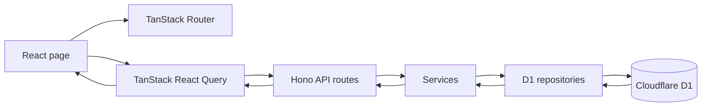

# SDE Intern Assignment: Shared Bill Splitter

## Stack 

- **API:** Hono on Cloudflare Workers
- **Database:** Cloudflare D1 (SQLite). The binding is `DB` in `api/wrangler.jsonc`.
- **Web:** React, Vite, TanStack Router
- **Language:** TypeScript on both sides
- **Tests:** Vitest, running inside the Workers runtime
- **Quality:** Biome. `pnpm check` and `pnpm typecheck` must pass.
- no additional form or validation library is used, native is used.

You choose the rest (styling, form library, validation library). Pick tools you can explain.

## The task

The assignment has two parts. Do Part 1 first. Part 2 builds on it.

**Database.** Write the schema as SQL migration files in `api/migrations/`. For example `0001_init.sql`. The tests apply every file in this folder. Your schema must have **at least 3 named constraints** that protect the data. For example a foreign key, a `CHECK`, or a `UNIQUE` key. Be ready to explain what each constraint stops.

**Errors.** Every error response is JSON: `{ "error": "message" }`.

## Part 1: Homes and members

Create a home and add members to it. The order in which members are added matters in Part 2.

#### `POST /api/homes`

- Request: `{ "name": string }`
- Success: `201` `{ id, name }`

#### `POST /api/homes/:homeId/members`

- Request: `{ "name": string }`
- Success: `201` `{ id, homeId, name }`
- Errors: `404` home not found

Visible tests: `api/test/homes.test.ts`.

## Part 2: Bill splitting

Add a bill to a home, split it between the members, and let each member pay their share.

All amounts are whole **cents** (integers). `100` cents is 1 dollar. Never use decimals for money.

#### `POST /api/homes/:homeId/bills`

- Request: `{ "title": string, "totalCents": number }`
- Success: `201` `{ id, homeId, title, totalCents, shares: [{ id, memberId, amountCents, paidAt: null }] }`
- Errors: `404` home not found. `422` total is not a positive whole number, or the home has no members.

#### `POST /api/bills/:billId/shares/:shareId/pay`

- Request: header `Idempotency-Key`
- Success: `200` `{ id, memberId, amountCents, paidAt }`
- Errors: `400` key missing. `404` bill or share not found. `409` share already paid with a different key.

#### `GET /api/homes/:homeId/balances`

- Success: `200` `{ balances: [{ memberId, name, outstandingCents }] }`
- Errors: `404` home not found

**Rules**

- **Split.** A bill is split between all members of the home. The shares always add up to `totalCents`. If the amount does not divide evenly, the extra cents go to the members one by one, in the order the members were added to the home. Example: 1000 cents between 3 members gives `334`, `333`, `333`.
- **Pay.** Paying marks one share as paid and sets `paidAt`. If the same `Idempotency-Key` is sent again for the same share, answer `200` with the same result. Do not pay twice. If two requests pay the same share at the same time, only one may succeed.
- **Balances.** `outstandingCents` is the sum of the member's unpaid shares, across all bills of the home. List the members in the order they were added.

Visible tests: `api/test/bills.test.ts` and `api/test/payments.test.ts`.

#### Web page

Build one page that:

- shows the bills of a home and the shares of each bill,
- lets a member pay a share,
- shows clear **loading**, **empty**, and **error** states,
- keeps the share unpaid and shows an error if the payment fails.

The page must not crash when the API answers with an error or is slow.

## Cases you must handle

You must handle these cases and talk about them in your video:

1. A home with no members.
2. An amount that is zero, negative, or not a whole number.
3. An amount that does not divide evenly.
4. The same payment request sent twice.
5. Two members paying the same share at the same time.
6. A bill or share that does not exist.
7. The API answers with a 500 error or is slow. The web page must not crash.

## Run it

This is a pnpm workspace. Install once at the root.

```bash
pnpm install
pnpm dev          # api on :8787 and web on :5173
```

Open http://localhost:5173. The starter page shows a title. `/api/health` returns `{ "status": "ok" }`.

```bash
pnpm test         # run the visible tests in api/test
pnpm check        # Biome: format and lint. Must pass.
pnpm check:fix    # fix what Biome can fix
pnpm typecheck    # tsc on both packages. Must pass.
pnpm build        # production build of the web app
```

`pnpm dev` applies your migrations to a local database before it starts the API.

If pnpm says some build scripts were ignored, run `pnpm approve-builds` and allow `esbuild` and `workerd`.

When you change `api/wrangler.jsonc`, refresh the `Env` types:

```bash
pnpm --filter bill-splitter-api cf-typegen
```

## Rules for the tests

- The visible tests are in `api/test`. They start with a failing result. Your job is to make them pass.
- Do **not** change the visible tests or `api/test/helpers.ts`. We compare them with the original.
- We run extra tests after you submit. They test the cases in "Cases you must handle" more closely.

## How to submit

1. Click **Use this template**, then **Create a new repository**. Make the repository **public**.
2. Build your solution in your new repository. Small, clear commits are welcome.
3. Update this README with a short section called **Decisions**. Write 3 decisions you made and why.
4. Record a video of **3 minutes or less** (Loom or unlisted YouTube). Show the architecture, the data flow, and one trade-off you made. Make sure anyone with the link can view it.
5. Paste the repository link and the video link in the application form.

We will run `pnpm install && pnpm check && pnpm typecheck && pnpm test` on your repository.

## Decisions

1. **Store money as integer cents.** This avoids floating-point rounding; any remainder is assigned in member insertion order for predictable splits.
2. **Separate routes, services, and repositories.** Hono routes handle HTTP, services enforce bill and payment rules, and repositories access D1. This keeps those responsibilities easier to understand and change.
3. **Make payment updates conditional and idempotent.** Each payment stores an `Idempotency-Key`, and the database updates a share only while it is unpaid. Repeating a key returns the stored payment, while a competing key gets a conflict.

## Architecture and data flow



React Query loads a selected home's bills, details, and balances in parallel. For changes, the page sends a request through Hono; the route calls a service, which validates the operation and uses a repository to read or update D1. JSON responses update or invalidate the matching React Query cache.

## Trade-off

Payment handling reads the share after a conditional update to learn whether this request's idempotency key won a race. That extra database read adds work, but lets concurrent attempts return either the same successful result or a clear conflict without double-paying the share.

## Folder structure and file map

```text
.
├── api/
│   ├── migrations/       # D1 schema migrations
│   ├── src/
│   │   ├── repositories/ # D1 reads and writes
│   │   ├── routes/       # Hono HTTP endpoints
│   │   ├── service/      # Home, member, bill, and payment rules
│   │   ├── utils/        # Validation, errors, and cent splitting
│   │   └── index.ts      # Worker app and route mounting
│   └── test/             # Vitest API tests and test helpers
├── web/
│   └── src/
│       ├── components/   # Page sections and forms
│       ├── routes/       # TanStack file routes and global styles
│       ├── api.ts        # Typed API requests
│       ├── storage.ts    # Saved spaces in local storage
│       ├── types.ts      # Shared web data types
│       └── main.tsx      # React, Router, and Query setup
├── package.json          # Workspace scripts
└── pnpm-workspace.yaml   # pnpm workspace definition
```

Key files: `api/src/service/payments.service.ts` coordinates idempotent payments; `api/src/utils/split.ts` distributes cents; `api/migrations/` defines the database schema; `web/src/routes/index.tsx` connects page state and mutations; and `web/src/components/BillsSection.tsx` renders bills and shares.
